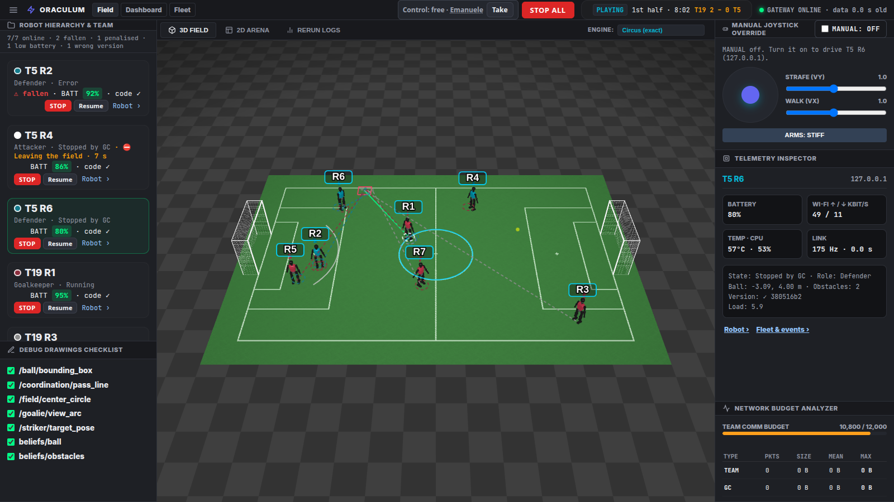
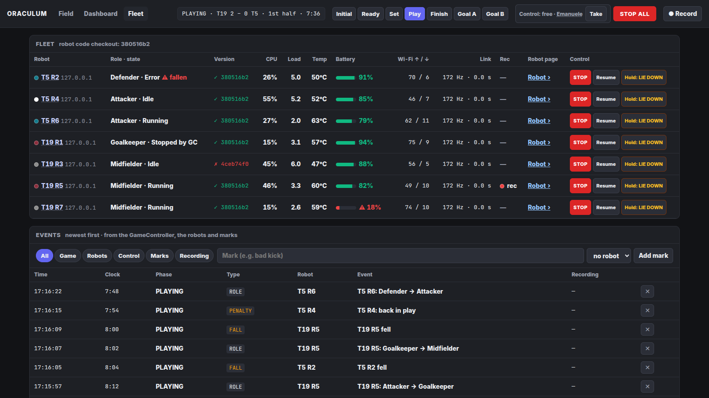
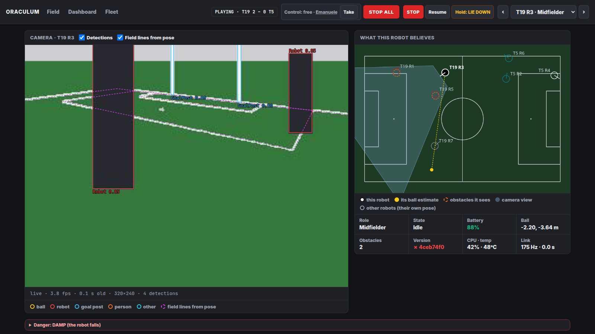
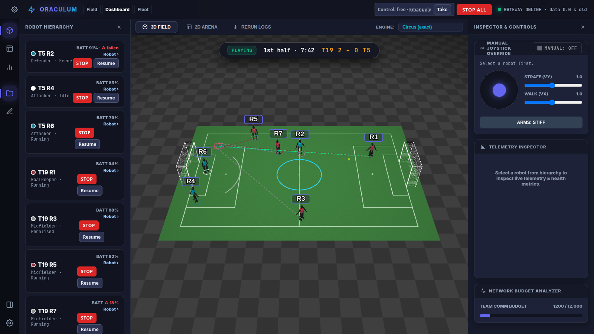
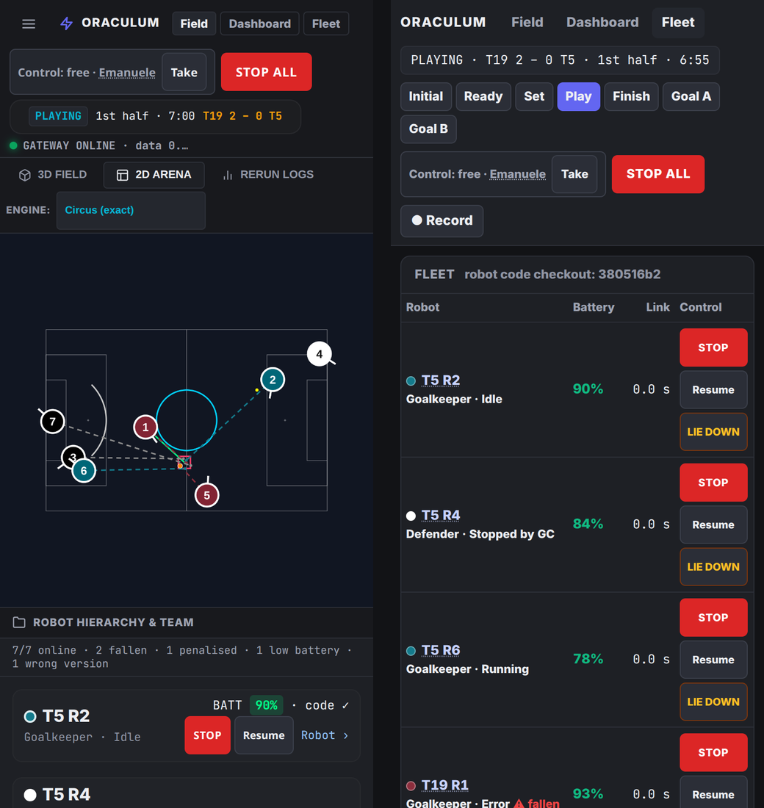
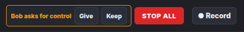
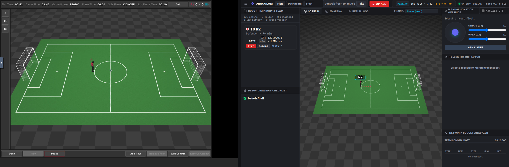

# Oraculum

**A humanoid fleet control room.** Oraculum is team SPQR's control room and debugging platform for a fleet of
humanoid robots (Booster T1 / K1) in RoboCup humanoid soccer. One gateway merges the telemetry of every robot with the
referee's GameController state; any browser, tablet, phone or the command line reads that one shared state, and can
stop or drive the robots under a single control lock. The same software runs as a hosted simulation session: a browser
opens a private copy of the team's robot code in the circus simulator, with nothing to install.



| | |
|---|---|
|  |  |
| **Fleet and events**: version, CPU, temperature, battery, Wi-Fi, link; STOP / Resume / LIE DOWN per robot; event log with marks; recordings with download. | **Robot page**: the robot's camera with its detections and the field lines projected from its own pose (a localisation check at a glance), its world model, the robot's controls. |
|  |  |
| **Dashboard**: the same live state in an IDE-like layout with docks. | **Phones and tablets**: every page works on a phone; STOP ALL is always in the header. |

## What it does

- **One shared state** for every client: robot poses, roles and states, battery, falls, each robot's own ball
  estimate and obstacles, debug drawings, software version against the gateway's checkout, link rate per robot,
  and the GameController (state, score, half, clock, set play, penalties per robot).
- **Exactly the simulator's picture**: the 3D view runs MuJoCo 3.3.3 and its classic renderer compiled to WebAssembly
  and replayed on WebGL2 (`renderer/`), on the scene circus itself exports. A 2D view works everywhere.
- **Safety and engineer mode** ([details](docs/SYSTEM.md#4-safety-and-engineer-mode)): STOP ALL in every header,
  STOP / Resume / LIE DOWN per robot, DAMP only behind a locked danger section on the robot page. One operator drives
  at a time: the others ask, the holder gives or keeps control. The referee rule blocks manual commands in READY, SET
  and PLAYING. Every action lands in the event log with the operator's name.
- **Events and recordings**: game phases, goals, penalties, falls, robots online/offline, role changes, low battery,
  manual marks; one recording at a time (telemetry, GameController, events as JSON lines), listed and downloadable,
  replayable with `tools/replay_rrd.py`.
- **Hosted simulation sessions** (`hosted/`): one isolated cloud sandbox per person with circus, the robot stack and
  its own gateway and referee; a launcher with GitHub login (team members only), limits and a usage log.



## Quick start

```bash
python3 run_oraculum.py                 # gateway on :8080 and the main page
python3 tools/udp_sender.py             # 7 simulated robots, if no robot runs
python3 src/oraculum_cli.py status      # also: walk, stop|lie|resume --ip IP|--all, damp --ip IP --really
tools/fetch_web_assets.sh               # once: MuJoCo WebAssembly + Booster T1 model for the "wasm" engine
python3 tools/fetch_circus_scene.py     # the exact circus scene + renderer from this repository's releases
```

The gateway needs only Python 3 and PyYAML. Pages: `/index.html` (field), `/dashboard.html`, `/fleet.html`,
`/robot.html?robot=<ip>|<id>`.

**On a robot** (`SPQRTeam/spqrbooster2026`, branch `oraculum-tcm`): set `useRerun: true` in `deploy.yaml`, deploy
with `pixi run deploy`. The robot sends telemetry to UDP 10006 and listens for oraculum on UDP 10007
(`ORACULUM_HOST` overrides the gateway address).

**Hosted session** (needs a Modal account): `hosted/stage.sh`, then
`python3 hosted/modal_session.py start` prints the links of a private session.



## How it fits together

```
GameController ──UDP 3838──► gateway ◄──UDP 10006 telemetry── robots
                              │  └──UDP 10007 joystick / STOP / LIE / DAMP──► robots
                              └──HTTP 8080 (/state, /stop, /control, /events, /recordings, …)──► browsers, phones, CLI
```

The full description (components, message contract, views, safety, hosted sessions with measured numbers,
limitations) is in [docs/SYSTEM.md](docs/SYSTEM.md).

| Folder | Content |
|---|---|
| `src/` | gateway (`control_server.py` and its modules), pages, shared page modules in `src/static/` |
| `renderer/` | the 3D renderer: MuJoCo classic renderer in WebAssembly, replayed on WebGL2; CI pixel tests |
| `tools/` | simulated robots, recording replay, scene export and fetch, checks |
| `hosted/` | hosted simulation sessions (Modal) and the web launcher with GitHub login |
| `docs/` | system description and screenshots |

## Status (2026-10-19)

Working and tested with simulated robots and in hosted circus sessions. Open:
- STOP on a walking robot: the switch to the firmware's standing pose made the robot fall in the simulator.
- LIE DOWN: the simulated firmware refuses the lie-down (disabled in its configuration).
- The robot side is not yet tested on a real robot.
