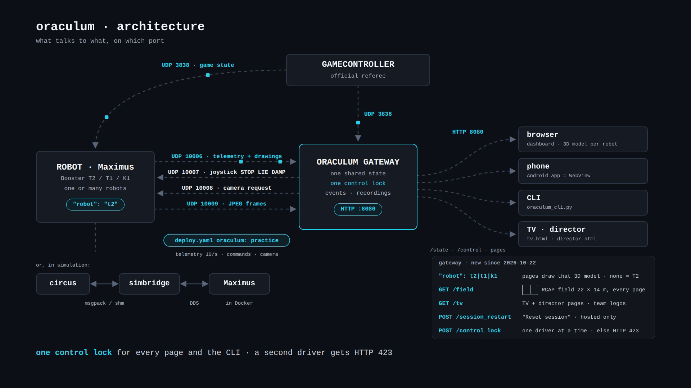

# Architecture and Ports

Result first: one gateway process (`src/control_server.py`) receives UDP from the robots and the GameController, keeps
one merged state in memory, and serves it over HTTP on port 8080. Every client (page, phone, CLI) polls that state.
Commands go back to the robots as UDP datagrams.



```
GameController ──UDP 3838 (binary game state)─────────────► robots, oraculum gateway
robot (Maximus) ──UDP 10006 (JSON telemetry + drawings)───► oraculum gateway
oraculum gateway ──UDP 10007 (JSON joystick, STOP, ...)───► robot (LowControlBridge)
oraculum gateway ──UDP 10008 (camera request)─────────────► robot (DebugCameraSender)
robot ──UDP 10009 (camera frames, 3 s per request)────────► oraculum gateway
robots ◄──UDP 10000+team (binary team messages)──────────► robots
browser, phone, CLI ◄──HTTP 8080 (/state, /control, ...)──► oraculum gateway
```

Some older design documents describe a desktop app, a Flutter app, a React app and a WebSocket server. These do not
exist. The pages use plain HTTP polling.

## Ports

| Port | Protocol | Direction | What | Set in |
|---|---|---|---|---|
| 8080 | TCP (HTTP) | clients → gateway | Pages and API | Fixed in `src/control_server.py` |
| 10006 | UDP | robot → gateway | Telemetry and debug drawings: 10/s in practice, 1/s in match | `config.yaml` `socket.port`; robot: `DebugMessageSender` |
| 10007 | UDP | gateway → robot | Joystick and safety commands (practice only) | Robot: `LowControlBridge` |
| 10008 | UDP | gateway → robot | Camera request (practice only) | Robot: `DebugCameraSender`; gateway: `src/camera_hub.py` |
| 10009 | UDP | robot → gateway | Camera frames, 4 per second for 3 s after each request | `config.yaml` `camera.port` (default 10009) |
| 3838 | UDP | GameController → all | Referee state (versions 19 and 20 of the packet) | `config.yaml` `game_controller.port` |
| 10000 + team | UDP | robot ↔ robot | Team messages (not read by oraculum) | Robot code |

## The gateway

- `UDPReceiver` (`src/socket_client.py`) merges the packets of all robots. A robot is keyed by its IP and its player
  number, so two teams can both have a robot 3. A robot disappears 3.5 s after its last packet.
- `GCReceiver` (`src/gc_client.py`) parses the GameController packet. `own_team` in `config.yaml` selects our team.
- `EventLog` and `Recorder` (`src/session.py`) detect events and write recordings.
- `CameraHub` (`src/camera_hub.py`) asks a robot for camera frames (at most once per second, only robots that send
  telemetry) and keeps the newest frame.
- `ControlLock` (`src/control_lock.py`) decides which operator may drive (see [Safety Controls](Safety-Controls)).
- `TVProgram` (`src/tv_program.py`) holds the program of the TV screens.
- `SimGameController` (`src/sim_gc.py`) is the simulated referee. It runs only with `ORACULUM_SIM_GC`.

## The robot side (spqrbooster2026)

| Part | File | Does |
|---|---|---|
| Settings | `src/app/utils/settings/Settings.h`, `Settings.cpp` | Reads `oraculum` and `oraculumHost` from `deploy.yaml`. Telemetry runs when `oraculum` is not `off` or `useRerun` is true. Remote control runs in `practice`, or in `off` with `useRerun`. |
| Telemetry | `src/app/nodes/communication_send/DebugMessageSender.cpp` | One JSON datagram per period (100 ms; 1000 ms in match) to the target. Target: `oraculumHost`; else env `ORACULUM_HOST`; else the host of `rerun.connectAddr` in `connect` mode; else the Wi-Fi broadcast. In match: `oraculumHost` only. |
| Camera | `src/app/nodes/communication_send/DebugCameraSender.cpp` | After a request on UDP 10008: 3 s of frames, 4 per second, a JPEG at most 320 px wide, the camera model and the detections. Practice only. |
| Commands | `src/app/nodes/bridge/LowControlBridge.h`, `.cpp` | Reads JSON datagrams on UDP 10007 with `"isManual": true`. While they arrive, they replace the remote controller; 500 ms after the last one, the remote controller is back. Sets the STOP, LIE and DAMP latches. Practice only. |
| Deploy | `scripts/deploy.sh` | `--no-rerun` (used by `deploy-match`) sets `useRerun: false` and turns `practice` into `match`. |

## HTTP routes

All routes need the access token when `ORACULUM_ACCESS_TOKEN` is set (`?token=` once, then the cookie).

| Route | Does |
|---|---|
| `GET /state` | The merged state: `agents`, `ball`, `drawings`, `texts`, `gamecontroller`, `fleet`, `rec`, `lock`, `bypass`, `last_event`, `tv`, `boot`. Add `?client=<id>` to keep your control lock alive. |
| `GET /field` | The field dimensions from `config.yaml` (`fields/*.yaml`, metres). |
| `GET /events?since=<id>` | Events newer than `id`. |
| `POST /events` | `{"add": {"text": "...", "robot": "T19 R3"}}` adds a mark; `{"delete": <id>}` deletes an event. |
| `POST /record` | `{"on": true, "by": "<name>"}` starts; `{"on": false, "name": "<recording name>"}` stops that recording. |
| `GET /recordings` | The list of recordings. `GET /recordings/<name>.jsonl` downloads one. |
| `GET /camera?robot=<ip>\|<id>` | The newest camera frame (JSON, JPEG in base64), or `{"status": "waiting"}`. Each call also asks the robot for 3 s of frames. |
| `POST /control` | A manual command `{ip, vx, vy, vtheta, isManual: true, client, operator, ...}`. Needs the control lock (else 423). Refused in READY, SET and PLAYING (403) unless `testingOverride` is true. |
| `POST /stop` | `{robot: "<ip>" or "all", kind: "stop" \| "lie" \| "damp" \| "resume", client, name, confirm}`. |
| `POST /control_lock` | `{action: "take" \| "release" \| "grant" \| "deny", client, name}`. |
| `GET /tv`, `POST /tv` | Read or change the TV program. |
| `POST /gc` | Only with the simulated referee: `{state, kicking_team, goal, half, penalty}`. Else 404. |
| `GET /static/<path>` | Files from `src/static/`. |
| `GET /`, `/dashboard`, `/fleet`, `/robot`, `/tv.html`, `/director` | The pages. |

## Message format

The telemetry schema is the set of dataclasses in the SCHEMA section of `src/socket_client.py` (`AgentMsg`, `BallMsg`,
`DrawingMsg`, `TextMsg`, `GameStateMsg`). New fields need a default value. The gateway ignores unknown fields.

- Units are metres and radians. The frame is the field frame. Robots of the colour in `frames.mirror_team_color`
  (default `blue`) send in their own team frame; the gateway mirrors them.
- Drawing coordinates: `circle [x, y]` with `size` = radius, `box [cx, cy, w, h]`, `line [x1, y1, x2, y2]`,
  `arc [x, y, r, start_deg, end_deg]`, `point [x, y]`. `tools/udp_sender.py` sends one of each.
- `joints` maps T1 joint names (for example `AAHead_yaw`) to radians. The MuJoCo 3D engine uses them.
- `sys` carries the fleet data: version, CPU, load, temperature, Wi-Fi traffic, robot log state.
- `latch` is the robot's answer to STOP, LIE DOWN and DAMP.

## Configuration

| File | Holds |
|---|---|
| `config.yaml` | Field file, ports, `own_team`, team colour to mirror, drawing paths to hide. |
| `config/teams.yaml` | Team numbers → names and colours (the TV shows "SPQR" for 19). |
| `fields/*.yaml` | Field dimensions. |

| Environment variable | Effect |
|---|---|
| `ORACULUM_ACCESS_TOKEN` | Every route needs this token. |
| `ORACULUM_SIM_GC="<team A>,<team B>"` | Runs the simulated referee. The gateway then ignores UDP 3838. |
| `ORACULUM_GC_TARGETS="<ip>,<ip>"` | The simulated referee sends to these IPs (default `127.0.0.1`). |
| `ORACULUM_CONTROL_IP` | Every command goes to this address, whatever the request says. Hosted sessions only. |
