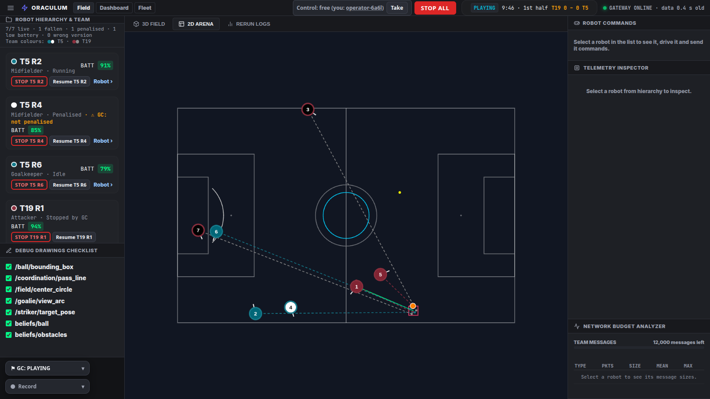
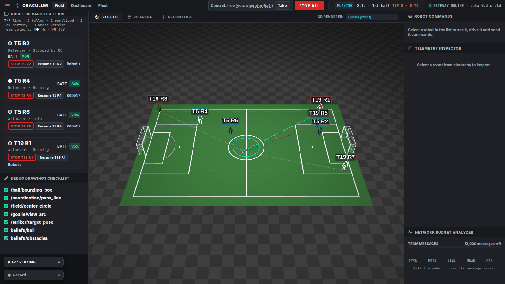
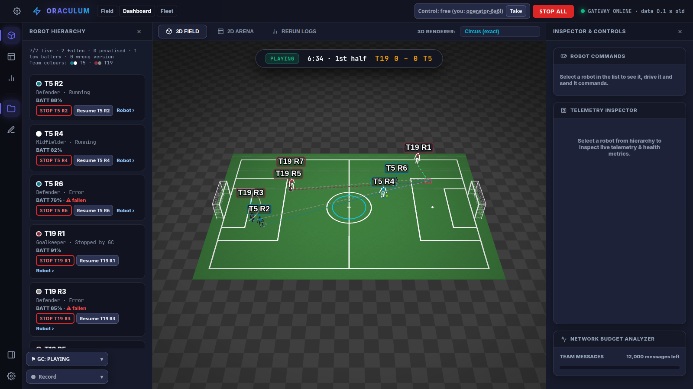
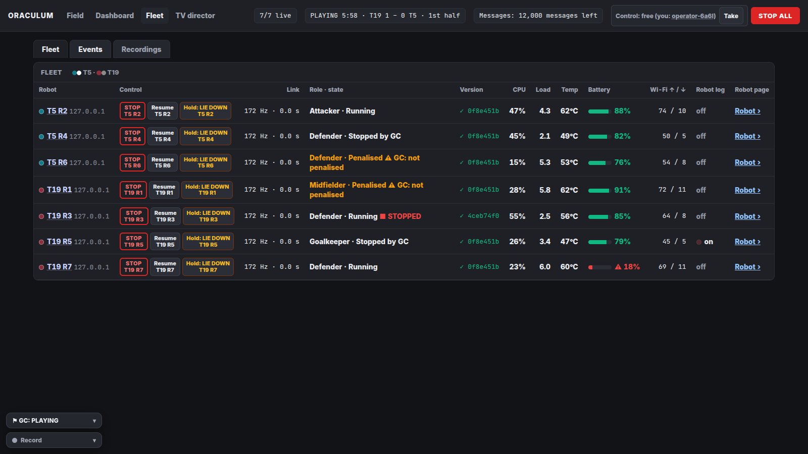
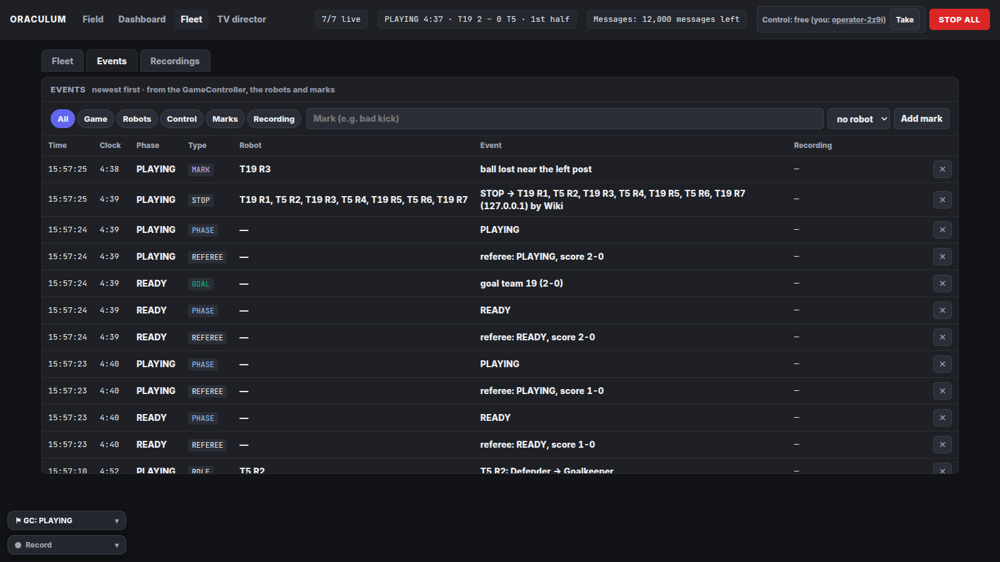
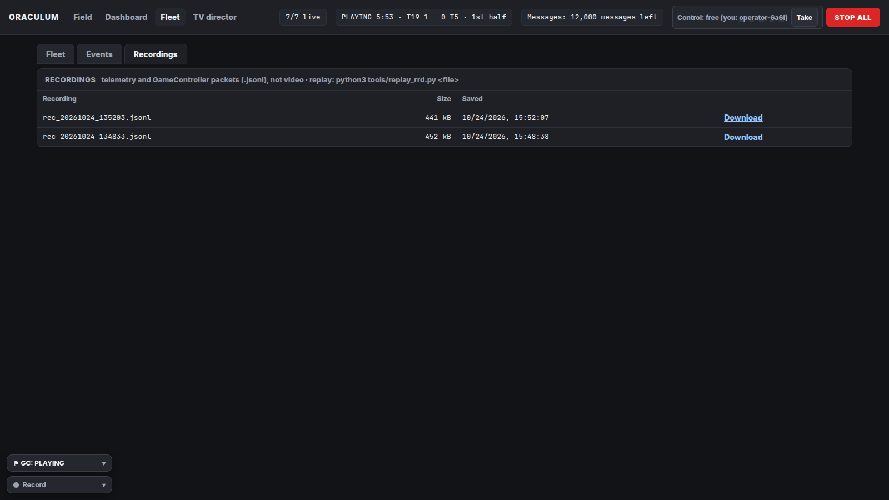
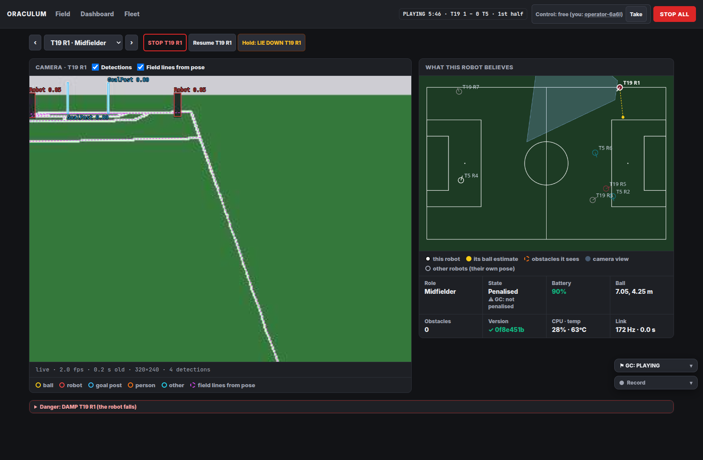
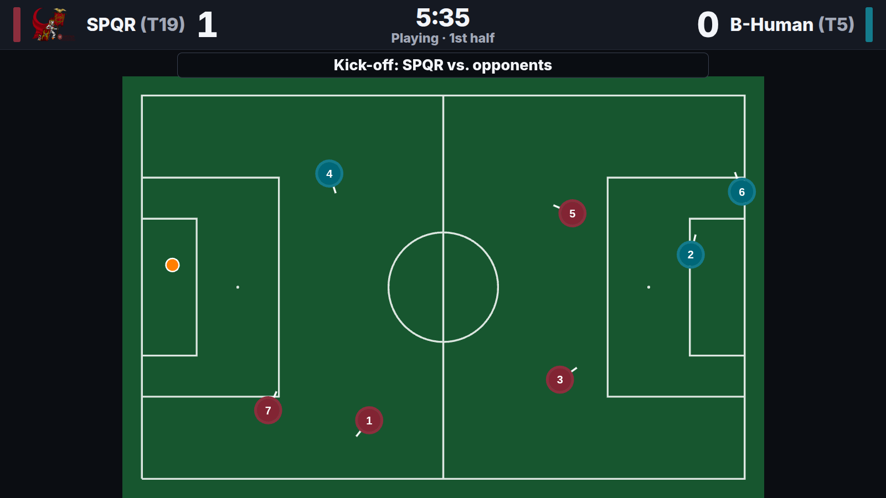
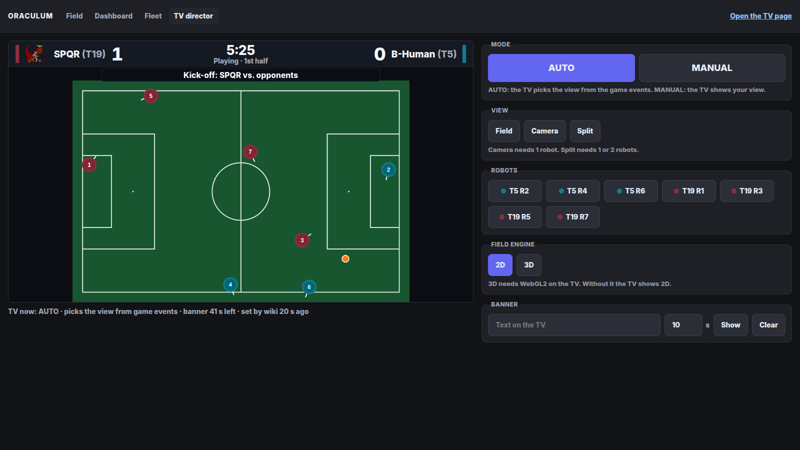

# Pages

Every client of oraculum is a web page that the gateway serves on port 8080. The pages ask the gateway for the state
(`GET /state`) several times per second. They need no configuration: they talk to the address they come from.

The UI is being reworked. This page describes each page by its purpose and its controls, not by its layout.
Button names can change.

## Common parts

Every page (except the TV) has these parts in its header or in a floating menu:

- **STOP ALL**: stops every robot that sent data in the last 60 s. See [Safety Controls](Safety-Controls).
- **Control lock chip**: shows who holds the control lock (who may drive a robot). You can Take, Release or ask for it.
- **Bypass chip**: a red chip that names the operator who drove a robot with the referee-rule bypass in the last 5 s.
- **MATCH chip**: an amber chip "MATCH — no commands" ("MATCH" on a phone) while the gateway runs with its match switch. Every command
  control of the page is then grey, with the rule in its tooltip. See [Match Mode and Rules](Match-Mode-and-Rules).
- **Record menu**: starts and stops a gateway recording.
- **Referee menu (GC)**: only with the simulated referee (`ORACULUM_SIM_GC`). Buttons for each game state and a goal
  for each team.

On a phone (below 600 px width) the Record and referee menus fold into one round button.

## Field (main view): `/`

Purpose: see the whole game, and drive one robot when needed.

- **Views**: 2D field, 3D field, or the Rerun view (`/?mode=2d`, `/?mode=3d`, `/?mode=rerun`).
  The Rerun view is an embedded viewer of the Rerun logging tool; it needs a Rerun server.
- **3D engine** (select box, saved in the browser):
  - "Circus (exact)" (default): the same scene and renderer as the circus simulator. It needs the files from
    `tools/fetch_circus_scene.py`.
  - "MuJoCo WASM (T1 model)": the real T1 robot model, posed with the joint angles from the telemetry. It needs the
    files from `tools/fetch_web_assets.sh`.
  - "Three.js": simple box robots. It needs no extra files.
  - When an engine cannot start, the page falls back: circus → MuJoCo → simple robots → a message with a 2D button.
- **Field**: the RCAP match field, 22 × 14 m (`fields/fieldRCAP.yaml`, since 2026-10-22), in 2D and in the circus
  scene `maximus_4v4_rcap`.
- **Robots**: a disc or a 3D robot per robot, with a label "T19 R3" (team 19, player 3) in the team colour.
- **Ball**: the team ball (the estimate of the robot nearest to its own estimate), and each robot's own estimate.
- **Debug drawings**: circles, boxes, lines, arcs and points that the robots send. A checklist shows or hides each
  drawing path. The choice is per browser.
- **Referee pill**: game state, score, clock, set play, penalties, and the team-message budget.
- **Robot inspector**: the data of the selected robot.
- **Robot command panel** ("ROBOT COMMANDS", right column; in the IDE-style view the inspector dock). Before you select
  a robot it shows only a hint. After you select a robot (in the list or on the field) it shows:
  - the robot's name, a live 3D miniature of the robot (its MuJoCo model, posed with the joint angles from the
    telemetry; a 2D disc without WebGL2), and its role, state, latch and go-to target;
  - the MANUAL switch and the on-screen stick with two speed sliders (only after a selection). See
    [Safety Controls](Safety-Controls);
  - STOP, Resume, **Get up**, **Sit down** (only for a T2), a 2 s press-and-hold LIE DOWN;
  - **Go to**: a list of positions from `GET /positions` (this robot's own READY and side-line positions first), with
    Go and Cancel;
  - **Drop**: the DAMP section (type the robot's name, then hold 3 s).

  For a robot in match mode (`sys.link = "telemetry"`) the new buttons are grey and their tooltip says why.
  Status: tested in a browser with fake robots (`python3 tools/panel_check.py`). Not tested with a real robot.
- **Bypass referee rules**: a menu switch with a confirmation dialog. It lets MANUAL commands through during READY, SET
  and PLAYING. Engineers only.

Below 1024 px width the page uses one column with the 3D view on top.

## IDE-style view: `/dashboard.html`

Purpose: the same data as the main view in a layout with more panels, for debugging at a desk.
It also has a settings panel where you can change the gateway address, and a timeline with a playback speed select
box.

## Fleet: `/fleet.html`

Purpose: the health of every robot, the event log and the recordings, in one page. It has three tabs.

### Fleet tab

One row per robot:

| Column | What it shows |
|---|---|
| Robot | Team and player number, IP. |
| Version | The deployed commit. It is marked when it is not equal to the commit of the `spqrbooster2026` checkout next to the gateway. `+dirty` = deployed with local changes. |
| Role · state | Role, state, and warnings: fallen, penalised, STOPPED / LYING / DAMPED, or a state that does not match the referee. |
| CPU, Load, Temp | CPU use, system load, temperature. Amber and red above limits. |
| Battery | Battery percent. |
| Wi-Fi ↑ / ↓ | Wi-Fi traffic of the robot. |
| Link | Packets per second as the gateway receives them, and the age of the last packet. |
| Robot log | Whether the robot records its own log (this is not the gateway recording). |
| Control | STOP, Resume, and a 2 s press-and-hold LIE DOWN. |
| Robot page | A link to the robot page. |

A robot that stops sending stays in the table for 60 s as an "offline" row with its last values.

### Events tab

The gateway logs events 5 times per second: game state, half, set play, goal, penalty, robot online and offline, fall,
role change, low battery (below 20 %), recording start and stop, control lock changes, and every STOP, LIE, DAMP and
RESUME with the operator name.

- Filter the log by type.
- **Add mark**: add your own event, for example "bad kick", with an optional robot.
- Delete an event with two clicks.

### Recordings tab

The list of recordings in `recordings/`, with size and a Download link.
Replay a recording with `python3 tools/replay_rrd.py recordings/<name>.jsonl --gc` (see [CLI](CLI)).

## Robot: `/robot.html?robot=<id or ip>`

Purpose: look through the eyes of one robot.

- `?robot=3`, `?robot=10.0.19.103` or `?robot=10.0.19.103|3` select the robot. With no match, or with two matches
  (two teams can both have a robot 3), the page shows a list of the online robots.
- **Camera**: the newest camera image, with the detections and the field lines drawn from the robot's pose and camera
  model. The page asks the robot for images only while it is open (practice mode only).
- **What this robot believes**: its ball estimate, the obstacles it sees, and the area its camera sees.
- **Data**: role, state, battery and the other telemetry values.
- **Controls**: STOP, Resume and a 2 s press-and-hold LIE DOWN.
- **Danger section** (closed by default): DAMP. See [Safety Controls](Safety-Controls).

## TV: `/tv.html`

Purpose: a public screen for the audience. It is read-only: it sends only GET requests, never touches the control lock
and has no robot controls.

- It shows the scoreboard, the field (2D by default, or the circus 3D view), up to 2 robot cameras, the penalties and
  a text banner.
- It shows no debug drawings, no beliefs, no health data and no event text.
- In AUTO mode it picks the shots itself from the game events: goal, penalty, game phase, set play.
- After FINISHED it shows "Half time", or "Full time" after the second half.
- With an access token, keep `?token=<secret>` in the kiosk bookmark.

## TV director: `/director.html`

Purpose: choose what the TV shows. The fleet page links to it.

- **AUTO / MANUAL**: in AUTO the TV picks its shots. Any view choice switches to MANUAL.
- **View**: Field, Camera, or Split (field and cameras).
- **Robots**: at most 2 robots, only robots that send data now.
- **2D / 3D**: the field engine of the TV.
- **Banner**: up to 80 characters, shown for 3–120 s (default 10 s). Clear removes it.
- **Preview**: the TV page itself, scaled, so you see exactly what the TVs show.

The director moves no robot and needs no control lock. All TVs show the same program. A gateway restart resets the
program to AUTO.

## Other pages

- `/ar_dashboard.html` serves the main view. The Android companion app opens this address.
- `/wasm_test.html` loads an old renderer that does not work. Do not use it.
